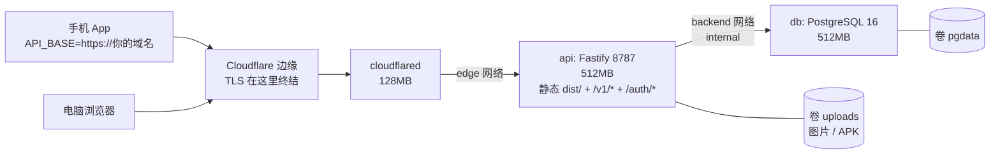

# 部署与运维手册

给未来的自己看的。按顺序做，每一步都有「怎么确认它成了」。

---

## 0. 这套东西长什么样



三条硬规则：

| 规则 | 为什么 |
|---|---|
| **宿主机不发布任何端口** | 唯一入口是 cloudflared 的出站长连接。没有任何入站端口 = 不用管防火墙、不用管公网 IP、家里 IP 变了也不影响 |
| **`backend` 网络是 `internal: true`** | 数据库容器连不出去，被攻破也打不了外网 |
| **API 和前端同进程** | 同源，没有 CORS、没有预检、没有跨域取图限制 |

资源按 4GB 内存的 NAS 配：512 + 512 + 128 ≈ 1.2GB，剩下的留给系统和 fnOS 自己。

---

## 1. 首次部署

### 1.1 前置

| 项 | 要求 |
|---|---|
| NAS | 飞牛 fnOS（其他 Linux NAS 一样），已装 Docker 与 Compose |
| 内存 | ≥ 2GB 可用。低于这个数 PostgreSQL 会频繁 OOM |
| 磁盘 | ≥ 10GB。图片按每张 1–2MB 算，一年几个家庭也就几个 GB |
| 域名 | 已托管在 Cloudflare（NS 在 CF 上，不是只加了 A 记录） |

### 1.2 建隧道（在电脑上做，不在 NAS 上）

```bash
# 1. 登录，浏览器会弹授权
cloudflared tunnel login

# 2. 建一条命名隧道，输出里记下 TUNNEL_ID
cloudflared tunnel create homework

# 3. 给域名指路（DNS 记录由 CF 自动加，是 CNAME 到 <TUNNEL_ID>.cfargotunnel.com）
cloudflared tunnel route dns homework homework.你的域名.com
```

`cloudflared tunnel create` 会在 `~/.cloudflared/` 生成 `<TUNNEL_ID>.json`。**把这个文件复制到 NAS 上的 `cloudflared/` 目录**，文件名保持 `<TUNNEL_ID>.json`（已被 `.gitignore` 排除，不会误提交）。

### 1.3 改两处配置

**`cloudflared/config.yml`** —— 把 `<TUNNEL_ID>` 和 `hostname` 换成自己的（两处 `hostname` 都要改：`ingress` 里的一行和 `httpHostHeader`）。

**`.env`** —— 从 `.env.example` 复制，四个值都要填：

```bash
cp .env.example .env

# 三个密钥这样生成
openssl rand -hex 24   # → POSTGRES_PASSWORD
openssl rand -hex 32   # → JWT_SECRET
openssl rand -hex 16   # → ADMIN_TOKEN

# APP_HOST 就是 1.2 里那个域名，不带 https://
```

> `JWT_SECRET` 少于 32 字符、`ADMIN_TOKEN` 少于 16 字符，服务端会**拒绝启动**并打印原因。这是故意的——短密钥等于没有。

### 1.4 起服务

```bash
cd /你的路径/study_up
docker compose up -d --build
```

第一次会构建镜像（拉 node:22-alpine、postgres:16-alpine，装两套 npm 依赖），大约 3–8 分钟，取决于上行带宽。之后改代码再 `--build` 就快得多。

### 1.5 确认它成了

按这个顺序查，**每一步都过了再往下走**：

```bash
# 1. 三个容器都是 Up，db 和 api 是 healthy
docker compose ps
#    NAME                 STATUS
#    homework-api-1       Up (healthy)
#    homework-db-1        Up (healthy)
#    homework-cloudflared-1  Up

# 2. 数据库迁移跑过了（api 启动日志里应该有这两行）
docker compose logs api | grep migrate
#    第一次起：  [migrate] 执行 0001_init.sql
#                [migrate] 完成，执行了 1 个
#    第二次起：  [migrate] 已是最新

# 3. 从公网能通（这是唯一有意义的检查，容器本地健康不代表隧道通）
curl -sS https://你的域名/healthz
#    {"ok":true}

# 4. 网页能开
curl -sSI https://你的域名/ | head -3
#    HTTP/2 200
```

`/healthz` 不是返回常量，它真的对数据库跑一次 `SELECT 1`，失败就 503。所以第 3 步过了 = 隧道通 + 进程活 + 数据库活。

### 1.6 建第一个家庭

浏览器打开 `https://你的域名`，点「我是家长」→ 填家庭名 → 拿到 6 位家庭码。

**这一步同时验证了写链路**：能生成码 = 数据库可写、`families` 表结构对、JWT 签发成功。

### 1.7 打新 APK

旧包装的是已经停用的 CloudBase 地址，必须重新构建：

```bash
# 在开发机上
tool/release.sh "首次自托管发布"
```

脚本会用 `.env` 里的 `APP_HOST` 拼出 `API_BASE` 打进包里，然后上传、校验、写 `app_releases`。装上新包后，以后的更新就走自己的服务器了。

---

## 2. 日常运维

### 看日志

```bash
docker compose logs -f api            # 业务请求，一行一个
docker compose logs -f cloudflared    # 隧道连没连上
docker compose logs --since 30m api   # 只看最近半小时
docker compose logs api | grep '"statusCode":5'   # 只看 5xx
```

日志已经限了大小（api/db 各 10MB × 3 份，cloudflared 5MB × 2），不会把 NAS 磁盘写满。

### 改代码后重启

```bash
docker compose up -d --build api      # 只重建 api
docker compose restart api
```

数据库不用管，卷是独立的。迁移在 api 启动时自动跑，`migrations/` 里的 SQL 必须**幂等**（`CREATE TABLE IF NOT EXISTS` 这一套），否则重启会炸。

### 升级依赖 / 换基础镜像

```bash
docker compose pull db cloudflared    # 只拉别人维护的镜像
docker compose up -d
```

`api` 是自己构建的，不要 `pull`。

### 发一次新版 App

见 `README.md` 的「发版流程」。核心就一句：`tool/release.sh "说明"`，它会自己构建、上传、校验、写表、回读。

### 加一个家庭

不用碰服务器。让对方打开网页点「我是家长」自己建，或者你在网页上建完把家庭码给他。

---

## 3. 故障排查

先跑这三条，多数问题看一眼就知道：

```bash
docker compose ps                    # 谁挂了
docker compose logs --tail 50 api    # 最近报了什么
curl -sS https://你的域名/healthz     # 全链路通不通
```

### 症状 → 原因

| 症状 | 最可能的原因 | 怎么查 / 怎么修 |
|---|---|---|
| 网页打不开，`curl` 报 `502` / `1033` | 隧道连着但 api 挂了 | `docker compose ps api`；`logs api` |
| 网页打不开，报 DNS 错 | DNS 记录没指到隧道 | Cloudflare 面板看那条 CNAME 是否指向 `<TUNNEL_ID>.cfargotunnel.com` |
| 网页能开但一直转圈，接口 502 | api 容器在重启循环 | `logs api`，最常见是 `JWT_SECRET` 太短被 `assertConfig` 拒了 |
| 登录返回 **429** | 撞了限流（同 IP 每分钟 10 次） | 等一分钟。真被恶意试码就换家庭码 |
| 登录返回 **400「家庭码是 6 位」** | 输入带了空格或全角 | 前端已 `trim + toUpperCase`，还报就是粘贴了别的东西 |
| 一切正常但提示「登录已过期」 | access token 12 小时到期，refresh 也失效（服务端 `sessions` 被清过 / `JWT_SECRET` 换过） | 重新登录。**换 `JWT_SECRET` 会让所有设备立刻掉线**，这是预期行为 |
| 图片一片空白，Network 里 404 | `uploads` 卷没挂上，或恢复数据时只灌了库没解压文件 | `docker compose exec api ls /data/uploads` |
| 图片 404 但 `ls` 有文件 | key 前缀对不上（`f/<familyId>/...`） | 看数据库 `images` 里的 key 和磁盘上的实际路径 |
| 数据库报 `too many connections` | `max_connections=30`，连接泄漏或并发异常 | `docker compose restart api`。真不够就调 compose 里的 `max_connections` |
| 磁盘满 / PostgreSQL `No space left` | 备份堆积或日志没轮转 | `du -sh backup/`；`docker system df` |
| 上传大图 413 | 单张上限 20MB | 换小图，或调 `config.maxImageBytes` 重建 |
| 手机装不上 APK | 下载地址是内网 IP，或证书不受信 | `curl -I <表里的 download_url>`；确认是 `https://` + 公网域名 |
| 更新提示永远不出现 | 打了包没跑 `release.sh` | `tool/version_status.sh` 看本地和线上差几版 |
| `docker compose` 所有子命令返回空 | Docker 守护进程没起（NAS 重启后没自启） | `sudo systemctl start docker`，或在 fnOS 的 Docker 应用里启动 |

### 一条容易踩的坑：系统代理

开发机上如果开着 Clash / V2Ray 一类，`curl http://127.0.0.1:8787/...` 会被系统代理接走并返回 **502**，报错看着像服务端挂了，实际服务端一个请求都没收到。

```bash
env | grep -i proxy        # 确认有没有 http_proxy
curl --noproxy '*' http://127.0.0.1:8787/healthz
```

`tool/release.sh` 和 `tool/version_status.sh` 里所有 curl 都带了 `--noproxy '*'`，就是这个原因。

---

## 4. 备份

```bash
ops/backup.sh                 # 备份一次
ops/backup.sh --list          # 看现有备份
ops/backup.sh --keep 30       # 保留 30 天（默认 14）
ops/backup.sh --dir /vol2/bk  # 备到另一块盘
```

会产生两个文件 + 一行清单：

```
backup/homework-db-20261109-231500.sql.gz      数据库全量
backup/homework-files-20261109-231500.tar.gz   图片与 APK
backup/MANIFEST.txt                            每次追加一行，含各表行数
```

**必须两个都备**。只备数据库，恢复后所有图片都是 404；只备文件，恢复后一条作业都不剩。

### 放到定时任务里

fnOS 的「计划任务」加一条，每天凌晨 3 点：

```bash
cd /你的路径/study_up && mkdir -p backup && ops/backup.sh >> backup/cron.log 2>&1
```

或者 crontab：

```
0 3 * * * cd /你的路径/study_up && mkdir -p backup && ops/backup.sh >> backup/cron.log 2>&1
```

`mkdir -p` 不能省：重定向发生在脚本运行**之前**，目录不存在的话 cron 直接失败，而你在界面上什么也看不到。

### 备份放哪（重要）

默认放 `backup/`，和源数据**同一块盘**。这只挡得住「手滑删库」「升级炸了」，挡不住磁盘坏掉。

真要防灾，二选一：

| 手段 | 做法 |
|---|---|
| 另一块物理盘 | `ops/backup.sh --dir /vol2/homework-backup` |
| 异地 | 让 fnOS 把 `backup/` 同步到网盘，或定期 `rsync` 到另一台机器 |

### 恢复演练（三个月一次，别省）

```bash
ops/backup.sh --drill
```

它会：拿最新的库备份 → `gzip -t` 验完整性 → 建一个**临时库 `homework_drill`**（不碰生产库）→ 导入 → 逐表比对行数 → 删掉临时库。

```
==> 演练对象 homework-db-20261109-231500.sql.gz（412 KB）
==> 完整性检查
    gzip 校验通过
==> 建临时库 homework_drill（不碰生产库 homework）
==> 导入
    导入完成

==> 行数比对  生产 / 恢复
    families           15 /     15  OK
    children           10 /     10  OK
    homework            7 /      7  OK
    app_releases        1 /      1  OK

演练通过：这份备份能恢复，行数和生产库一致。
```

**行数对不上就别指望这份备份。** 通常意味着备份是在写入过程中拍的（概率低），或者磁盘有坏块。

演练只验数据库。图片要另外确认：解压 `homework-files-*.tar.gz` 后随机打开一张，能看就是好的。

---

## 5. 恢复

### 5.1 只恢复了数据库（图片还在）

```bash
cd /你的路径/study_up
gunzip -c backup/homework-db-<时间>.sql.gz \
  | docker compose exec -T db psql -U homework -d homework -v ON_ERROR_STOP=1
docker compose restart api
```

备份是用 `--clean --if-exists` 导的，所以**能把现有数据整个覆盖回去**，不会因为「表已存在」报错。用 `-v ON_ERROR_STOP=1` 是必须的：中途错了要立刻停，别留一个半截库还以为是成功。

### 5.2 图片也要恢复

```bash
# 先把 api 停掉，避免边解压边被读
docker compose stop api

docker run --rm \
  -v homework_uploads:/data \
  -v "$PWD/backup":/backup:ro \
  alpine:3 sh -c "rm -rf /data/uploads && tar xzf /backup/homework-files-<时间>.tar.gz -C /data"

docker compose start api
```

`homework_uploads` 是 compose 生成的卷名（项目名 `homework` + 卷名 `uploads`）。用 `docker volume ls | grep uploads` 确认。

### 5.3 换一台机器（灾难恢复）

新机器上按第 1 节做到 1.4 之前，**先别 `up`**，改成：

```bash
# 1. 只起数据库
docker compose up -d db
sleep 10   # 等 pg_isready

# 2. 灌库
gunzip -c /旧盘备份/homework-db-<时间>.sql.gz \
  | docker compose exec -T db psql -U homework -d homework -v ON_ERROR_STOP=1

# 3. 还原图片（卷还不存在时会自动建）
docker run --rm -v homework_uploads:/data -v /旧盘备份:/backup:ro alpine:3 \
  sh -c "mkdir -p /data && tar xzf /backup/homework-files-<时间>.tar.gz -C /data"

# 4. 起剩下的
docker compose up -d

# 5. 验证
curl -sS https://你的域名/healthz
```

`.env` 要沿用**旧的 `JWT_SECRET`**，否则所有设备掉线、必须重新登录（家庭码不用变）。

DNS 那边不用动——隧道是出站长连接，新机器上的 cloudflared 用同一份凭据连上去，CF 自动把流量切过来。

---

## 6. 明确接受的取舍

写下来是为了以后不用重新纠结：

| 取舍 | 代价 | 为什么接受 |
|---|---|---|
| **图片公开读** | 拿到完整 key 的人能看图 | `` 标签带不了 `Authorization` 头。key 里是 UUID，猜不出来；真要鉴权得上签名 URL，复杂度和收益不成比例 |
| **家庭码即凭证** | 拿到 6 位码就能进 | 没有账号体系。限流 10 次/分钟 + 32^6 的空间，暴力试不出来 |
| **家里断电就不可用** | 断多久停多久 | 自托管的固有代价。数据在本机，比托管在会 `res_stopped` 的地方强 |
| **上行带宽** | 一个人下 50MB 包要 15–20 秒 | 三五个家庭够用 |
| **没有备份到异地（默认）** | 磁盘坏了就全没了 | 需要额外配一块盘或网盘同步，见 4.「备份放哪」 |
| **多人同时改同一条正文，后写的赢** | 极端情况下丢一次编辑 | 没有冲突检测。实际两年没撞过 |
| **旧 APK 收不到这次更新** | 每台设备要人工装一次新包 | 旧包里的地址指向已停用的环境，改不了。装完这一次之后就走新通道了 |
| **孩子端首次登录要输家庭码** | 孩子自己记不住，得家长帮着输一次 | 原来靠匿名 token + 客户端查姓名，那套在公网等于把全库敞开 |
